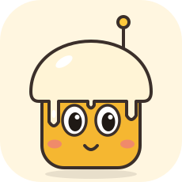
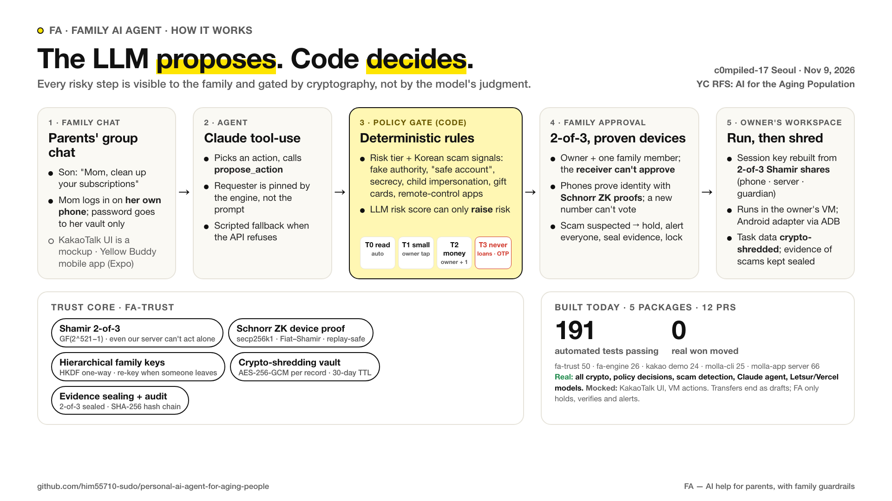
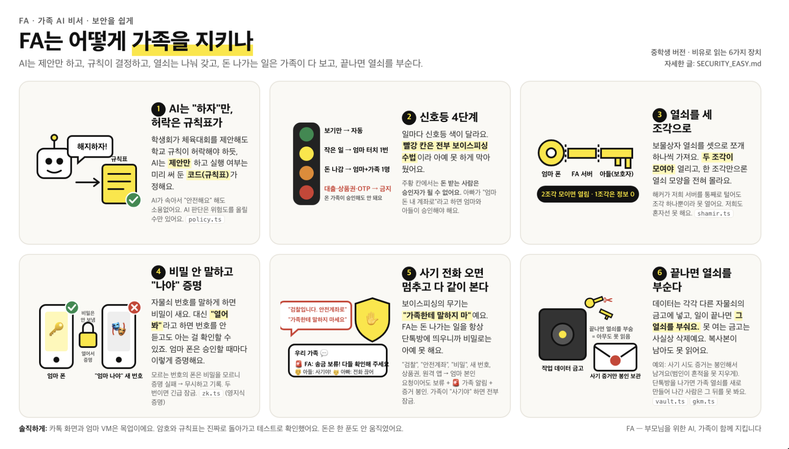

# Molla — Personal AI Companion

노년층과 가족을 위한 개인 AI 동반자입니다. React Native 모바일 앱과 독립 CLI를 각각 실행할 수 있습니다.

## 모바일 앱

흰색·노랑·검정의 대화 중심 UI입니다. iOS/Android용 Expo 앱이며 WebView 래퍼가 아닙니다.

- [모바일 설치와 실행](molla-app/apps/mobile/README.md)
- [디자인 시스템](molla-app/DESIGN.md)
- [화면 검증과 한계](molla-app/docs/design/VERIFICATION.md)
- [서버 연결 계약](molla-app/docs/live-api-handoff.md)

```sh
cd molla-app/apps/mobile
pnpm install --frozen-lockfile
pnpm start
```

앱의 인증된 Node API, Letsur/Vercel AI 연결, 사용자별 기억·권한·승인, Android 실행 어댑터가 `molla-app/server`에 있습니다. [서버 설치·실행](molla-app/README.md)과 [현재 검증 범위](molla-app/docs/STATUS.md)를 확인하세요. 모델 키·개인 접속 코드·실행 DB는 각 운영 환경에서 설정합니다.

실제 Letsur 및 Vercel 모델의 한국어 응답과 초안 생성은 검증했습니다. Android 화면 확인은 앱에 구현되어 있고 테스트를 통과했지만, 실제 클라우드 VM 실행은 사용자 요청에 따라 시작하지 않았습니다. 일반인의 휴대폰을 설치·동의 없이 인터넷에서 원격 제어하는 기능은 아닙니다.

## 독립 CLI

**웹 서버·HTTP API·브라우저 없이 실행하는 독립 CLI와 라우팅 스킬입니다.**

- [CLI 실행법](molla-cli/README.md)
- [라우팅 스킬 SKILL.md](molla-cli/skills/molla-router/SKILL.md)
- [담당자 인계](molla-cli/docs/HANDOFF.md)
- [명령 목록](molla-cli/docs/capabilities.json)

Node.js 24 이상에서 시작하세요. npm 설치나 웹 앱 체크아웃은 필요 없습니다.

[FA 엔진](fa-engine/README.md)은 카카오톡형 단톡방 데모용 로컬 API 서버(가족 권한 엔진 + Claude 에이전트)입니다. Molla CLI v0.2는 HTTP 없이 독립 실행되므로 FA 엔진 없이도 동작합니다 (`cd fa-engine && npm install && npm start`).

```sh
node molla-cli/bin/molla.mjs capabilities
node molla-cli/bin/molla.mjs health
```

v0.2는 로컬 SQLite와 권한·실행 코어를 직접 사용합니다. 승인 비교는 원자적으로 처리하며, 승인 후 `task execute`를 명시적으로 호출합니다. 15개 테스트에는 웹 사용을 금지한 독립 패키지 실행 검증이 포함됩니다.

현재 기본 실행은 로컬 초안입니다. 실제 클라우드 Android VM은 운영자가 소유자별 ADB 연결을 준비해야 하고, 운영 인증·VM 생성·자동 결제/전송은 포함하지 않습니다.

## 치즈 (FA) 카카오톡 데모



**치즈**는 가족이 점심으로 함께 먹은 크라이치즈버거에서 이름을 따온 다정하고 꼼꼼한 우리 가족 AI 도우미입니다.

[카카오톡 목업과 중앙 FA 라우터](fa-kakao-demo/README.md)에서 가족별 VM 선택, 조회 위임, 소유자 승인 흐름을 로컬 샘플로 시연합니다. 송금 승인·보이스피싱 보류·긴급 잠금 같은 보안 장면은 [fa-trust 보안 코어](fa-trust/README.md)가 판정하고, 채팅방에서 치즈를 누르면 열리는 **신뢰 패널**에 표시됩니다. 조회·해지 판단에는 [FA 엔진의 권한 엔진](fa-engine/src/policy.js)이 함께 쓰이고, fa-trust 없이 실행하면(`FA_TRUST=off`) 송금은 FA 엔진의 가족 멀티시그(계정 주인 + 가족 1명, 요청자·수혜자 제외)로 처리됩니다.

## 기술 스택과 신뢰 설계

**모델은 작업을 제안하고, 정책 코드가 실행 권한과 필요한 승인을 결정합니다.** 아들이 “엄마 구독 정리해줘”라고 하면 서버는 요청자를 아들로 기록하고, 엄마의 작업 공간과 조회 권한을 확인합니다. 해지는 엄마가 해당 건을 승인해야 진행됩니다. [권한 엔진](fa-engine/src/policy.js) · [카카오톡 라우터](fa-kakao-demo/router.mjs)

| 구성 | 기술과 역할 |
| --- | --- |
| 카카오톡 목업 | Node.js HTTP 서버와 브라우저 JavaScript로 가족방, 권한 카드, 신뢰 패널을 시연합니다. 구독 요청은 자체 라우터로 처리하고, 일반 대화는 OpenAI 호환 모델을 선택해 연결할 수 있습니다. [카카오톡 데모](fa-kakao-demo/README.md) |
| FA 엔진 | 별도 Node.js 서버에서 Claude 도구 호출을 구조화한 작업으로 받아 권한 엔진에 전달합니다. 요청자는 서버의 데모 세션에서 정합니다. 모델 설정이 없거나 정책 엔진에 작업을 보내기 전에 모델 호출이 실패하면 규칙 기반 응답으로 전환합니다. 카카오톡 목업은 이 엔진의 권한 모듈을 가져다 씁니다. [FA 엔진](fa-engine/README.md) · [Claude 도구 호출](fa-engine/src/agent.js) |
| 신뢰 코어 | TypeScript로 위험 등급, 한국어 사기 신호, 기기 증명, 키 분할과 증거 봉인을 구현합니다. 카카오톡 목업의 송금 시연에 연결됩니다. [fa-trust](fa-trust/README.md) |
| Yellow Buddy | Expo·React Native iOS/Android 앱과 인증된 Node.js API로 구성합니다. Letsur 또는 Vercel AI Gateway로 한국어 대화와 작업 초안을 만들고, 소유자에게 연결된 Android 기기용 ADB 실행·화면 캡처 어댑터를 제공합니다. [모바일 앱](molla-app/README.md) · [검증 범위](molla-app/docs/STATUS.md) |
| Molla CLI | Node.js 24 이상과 로컬 SQLite로 실행되는 별도 CLI입니다. 버전이 있는 JSON 작업을 받아 허용 목록을 확인하고, 승인 후 명시적 실행 명령을 받습니다. [CLI](molla-cli/README.md) · [라우팅 스킬](molla-cli/skills/molla-router/SKILL.md) |

### 작업 위험도에 따른 승인

| 등급 | 정책 |
| --- | --- |
| T0 · 조회 | 소유자 또는 조회 권한을 받은 가족이 확인합니다. |
| T1 · 연결·소액 작업 | 계정 연결은 소유자가 확인합니다. `fa-trust`에서 본인 확인을 마친 소유자의 주문은 기본 5만 원 이하일 때 추가 승인 없이 진행할 수 있습니다. |
| T2 · 송금·구독 해지 등 | 소유자 승인이 기본입니다. `fa-trust`는 타인의 요청, 신규 수취인, 100만 원 이상 등 정책 조건에 해당하면 가족 한 명의 확인을 추가합니다. 송금받는 가족은 공동 승인에서 제외하며, 신규 수취인 송금에는 기본 3시간 대기를 적용합니다. |
| T3 · 금지 | 대출, 계좌 개설, 상품권 구매, OTP 전달, 원격제어 앱 설치 등은 승인으로도 실행할 수 없습니다. |

기관·자녀 사칭, 안전계좌, 비밀 유지 요구 등은 보이스피싱 신호로 검사합니다. 기준을 넘으면 작업을 기본 24시간 보류하고 가족에게 알린 뒤 증거를 봉인합니다. 명시적 사기 신고나 같은 요청에 대한 반복 사칭 승인 시도는 긴급 잠금을 발동합니다. 모델의 숫자 점수는 위험 신호를 추가할 수 있으며, 최종 승인 조건은 정책이 집행합니다. [위험 판정 코드](fa-trust/src/policy.ts) · [보류와 잠금](fa-trust/src/trust.ts)

### 열쇠와 증거 관리

| 기술 | 역할 |
| --- | --- |
| Shamir 2-of-3 | 유한체 GF(2⁵²¹−1)에서 세션 키를 소유자 기기·서버·보호자 기기의 세 조각으로 나눕니다. 키 복원에는 두 조각이 필요합니다. 이 조각 수는 작업을 승인하는 가족 인원수와 별개의 조건입니다. [키 분할](fa-trust/src/shamir.ts) |
| Schnorr 영지식 기기 증명 | secp256k1과 Fiat–Shamir를 사용해 등록한 기기가 비밀키를 알고 있음을 증명합니다. 증명을 가족·구성원·작업에 연결해 같은 승인 증명의 재사용을 막습니다. [기기 증명](fa-trust/src/zk.ts) |
| HKDF-SHA256 가족 키 | 코어에서 구성원을 제거하거나 긴급 잠금할 때 가족 키를 갱신하고 공유 메모리를 다시 암호화합니다. [가족 키](fa-trust/src/gkm.ts) · [구성원 관리](fa-trust/src/trust.ts) |
| AES-256-GCM 금고 | 레코드마다 별도 키를 쓰고, 작업 금고의 키는 작업 종료나 TTL 만료 시 제거합니다. 계정 연결 세션의 기본 TTL은 30일입니다. [금고](fa-trust/src/vault.ts) · [세션·작업 수명](fa-trust/src/trust.ts) |
| 증거 봉인과 감사 | 사기 증거는 작업 데이터와 별도 키로 암호화하고 두 기기 조각으로 열 수 있게 합니다. 감사 기록은 SHA-256 해시 체인으로 연결합니다. [증거 봉인](fa-trust/src/evidence.ts) · [감사 체인](fa-trust/src/audit.ts) |

### 실제 연결과 시연 범위

저장소에는 정책·암호화 코드와 테스트가 있으며, Letsur와 Vercel의 실제 한국어 응답과 작업 초안 생성을 확인한 기록이 있습니다. 카카오톡 화면, 가족 역할과 구독 작업 공간은 로컬 샘플이고, 송금은 초안 또는 시뮬레이션 영수증에서 끝납니다. Android 어댑터는 구현되어 있으며 실제 클라우드 기기에서의 작업 실행과 화면 캡처는 검증 범위에 남아 있습니다. [카카오톡 데모 범위](fa-kakao-demo/README.md#llm-설정과-데모-범위) · [모바일 구현·검증 상태](molla-app/docs/STATUS.md)

<details>
<summary>발표 자료에서 보는 기술 흐름과 쉬운 보안 설명</summary>





위 그림은 2026-11-09 발표용 요약입니다. 세부 승인 조건과 구현 범위는 이 README의 표를 기준으로 확인할 수 있습니다.

</details>
