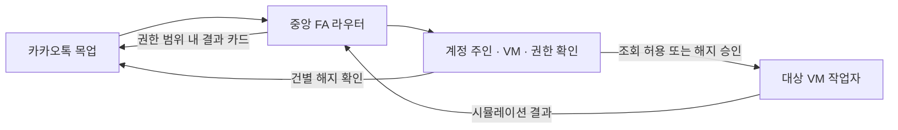

# Family AI Agent 카카오톡 목업

Family AI Agent는 60세 이후 부모 세대가 익숙한 카카오톡 단톡방에서 생활 업무를 요청하고, AI에 익숙한 가족이 방문 없이 도울 수 있게 하는 제품이다. 이 프로젝트는 중앙 FA가 **요청한 사람**, **계정 주인과 그 사람의 VM**, **허용된 작업**을 구분하는 부분을 시연한다.

## 바로 실행

Node.js 22.13 이상이 필요하다. 저장소 루트에서 아래 명령을 실행한다. 별도 패키지 설치 없이 시작할 수 있다.

```sh
cd fa-kakao-demo
npm start
```

브라우저에서 [카카오톡 데모](http://127.0.0.1:4173/)를 연다. 포트를 바꾸려면 `PORT=4174 npm start`처럼 실행한다.

## 발표 순서

1. **아들** 화면에서 **우리 가족** 방을 열고 **FA 초대 → 추가**를 누른다. 새 방부터 보여주려면 **새 채팅 → 일반채팅 → 친구 선택 → 방 이름** 순서로 시작한다.
2. **“엄마 구독 좀 정리해줘”**를 보낸다. 아들 화면에서는 엄마 전용 버튼이 잠긴다.
3. 화면 상단 **보는 사람 → 엄마**를 선택한다. **데모 계정 연결하기**에서 샘플 계정을 고른 후 **목록 보기 허용**을 누른다.
4. **아들** 화면에서 **엄마 구독 목록 보기 → 티빙 해지 요청**을 누른다. 아들이 선택한 서비스와 실행 대상인 **엄마의 VM**이 표시된다.
5. **엄마** 화면에서 **해지 승인하기**를 누른다. FA가 엄마 VM 작업자의 시뮬레이션 결과를 가족톡에 공유한다. **구독 목록 다시 보기**를 누르면 티빙이 빠진 샘플 목록을 볼 수 있다.

- VM 전환을 보여주려면 **아들** 화면에서 **“아빠 구독 목록 보여줘”**를 보낸다. **아빠**가 자신의 데모 계정을 연결하고 조회를 허용하면 아빠 VM의 별도 샘플 목록이 나온다.
- 입력 폼을 따로 시연하려면 **“@FA 서비스 이름 입력을 요청해줘”**를 보낸다. 샘플 응답 모드에서 바로 재현할 수 있다.
- 권한 차단을 보여주려면 **아빠** 화면에서 **“엄마의 계좌에서 50만원만 내 계좌로 옮겨줘”**를 보낸다.
- 방 메뉴에서 참가자 보기·초대, 챗봇 추가·내보내기, 이름 변경, 알림 토글, 상단 고정, 텍스트 내보내기, 조용히 나가기를 할 수 있다. 목록 검색과 방 안의 대화 검색도 사용할 수 있다.
- 대화 기록은 브라우저에, 권한과 VM 작업 상태는 서버 메모리에 저장된다. **시연 안내 → 처음부터 다시 시연**으로 새 샘플 상태를 시작할 수 있다.

## 중앙 FA 라우터 설계

1. **요청 해석.** 브라우저가 발신자와 방 정보를 `/api/router`에 보내면 서버가 메시지에서 지원하는 작업과 대상 후보를 찾는다. 사람이나 서비스가 모호하면 확인을 요청한다. 지원하는 구독 요청은 규칙 기반으로 해석한다.
2. **작업 공간과 권한 결정.** 라우터는 등록된 소유자와 VM의 대응표에서 작업 공간을 고른다. 부모가 아들에게 부여한 조회 권한은 해당 방의 참여자 구성을 기준으로 저장한다. 가족이 함께 볼 권한을 거절하면 계정 주인에게만 결과가 보인다. 구성원이 바뀌면 기존 위임과 승인 카드를 닫는다.
3. **정확한 작업 승인과 위임.** 해지는 한 방에서 한 건씩 검토한다. 요청자·작업 공간·서비스를 보여주고, 해당 소유자가 승인하면 서버가 현재 요청 ID와 단계 ID를 대조하고 한 번 소비한다. [VM 위임 스킬](skills/fa-vm-delegation/SKILL.md)에 정의한 형식으로 실행 작업을 보낸다.
4. **상태 보고.** [VM 작업자](vm-agent.mjs)는 엄마·아빠·아들의 별도 샘플 데이터에서 조회나 해지를 수행한다. [라우터](router.mjs)는 작업 ID와 응답 상태를 확인하고 허용된 대상에게 결과 카드를 표시한다. 지원하지 않는 송금은 차단한다.



위임 스킬은 Molla의 작업 허용 목록, 버전이 명시된 JSON 요청, 소유자 확인과 상태 보고를 참고했다. [Molla 라우팅 스킬](https://github.com/him55710-sudo/personal-ai-agent-for-aging-people/blob/4706c12d7d6b2d9fa527a082f9bd6a2c2dc51119/molla-cli/skills/molla-router/SKILL.md)

## LLM 설정과 데모 범위

기본 실행은 서버가 **샘플 응답**을 표시한다. 실제 응답을 사용하려면 실행 환경에 `FA_MODEL`과 `FA_API_KEY` 또는 `FA_API_BASE_URL`을 지정한다. API 주소를 생략하면 OpenAI 기본 주소를 사용한다. 호환 API 주소는 `/v1`까지 설정하고 서버가 `/chat/completions`를 붙인다. 참고 값은 [env.example](env.example)에 있으며, API 키는 실행 환경에만 설정한다.

설정 후 라우터에서 처리하지 않은 일반 질문은 해당 방에서 FA와 주고받은 최근 일반 대화와 함께 API로 전송된다. FA는 서비스 이름, 원하는 시간, 도움받을 내용을 입력 카드로 요청할 수 있다. 연결된 모델의 답변에는 **LLM 응답** 표시가 붙는다. 모델 응답에는 VM 작업이나 승인 상태를 바꾸는 경로가 없다.

브라우저에서 선택한 역할은 데모 발신자다. 실제 카카오톡 발신자 인증과 원격 VM 연결 없이, 로컬 서버의 작업자가 샘플 데이터를 변경한다. 테스트용 OpenAI 호환 서버로 HTTP 요청, 모델 응답, 입력 폼 왕복을 확인했다.

## 구현 및 검증 근거

- `npm test`는 일반 응답과 입력 폼, VM 선택과 격리, 조회 허용, 건별 승인, 이전 카드 재사용 차단, 공개 범위를 검증한다.
- REA 4.1.0으로 격리한 Chrome에서 공개 도움말의 DOM과 접근성 정보를 확인하고, 공식 화면을 참고해 모바일과 PC 흐름을 재현했다. [REA](https://github.com/morluto/rea) · [그룹 채팅](https://talktips.kakao.com/easyread/content/50) · [챗봇 추가](https://talktips.kakao.com/content/84) · [채팅방 나가기](https://talktips.kakao.com/easyread/content/55) · [Pickle 로그인 카드](https://pickle.com/help/connect/save-login)
